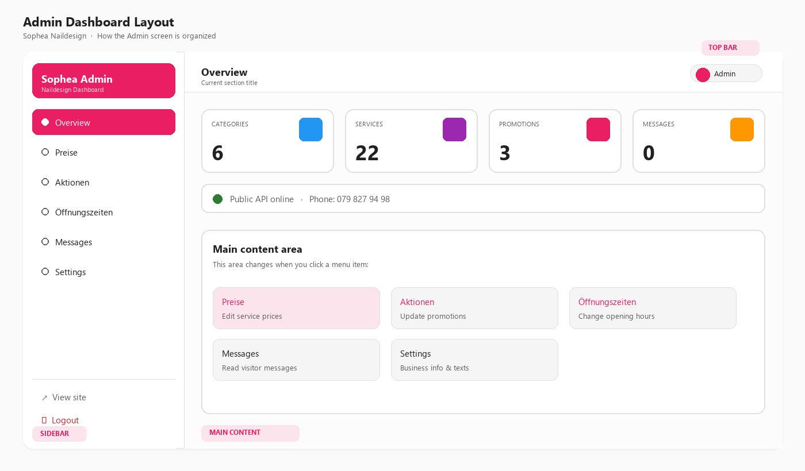

# Admin User Guide

**Sophea Naildesign — Content Management System**

| | |
|---|---|
| **Audience** | Salon owner / staff |
| **Prepared by** | Kalapak Team |
| **Version** | 1.0 |
| **Date** | 10 August 2026 |

This guide explains how to update website content without writing code.

---

## 1. How to log in

1. Open your browser.  
2. Go to the Admin login page:  
   - **Local / review:** `http://localhost:3000/admin/login`  
   - **Production:** `https://YOUR-DOMAIN/admin/login` *(replace with your live domain)*  
3. Enter your email and password.  
4. Click **Anmelden**.

You will land on the **Overview** dashboard.

### Default account (temporary)

| Field | Value |
|-------|-------|
| Email | `admin@sopheanaildesign.ch` |
| Password | `admin123` |

**Change this password before the website goes public.**

---

## 2. Dashboard layout

The Admin screen is organized into three clear areas:



| Area | Meaning |
|------|---------|
| **Sidebar** | Main menu — switch between Overview, Preise, Aktionen, Öffnungszeiten, Messages, Settings |
| **Top bar** | Shows the current section title |
| **Main content** | Where you edit data for the selected menu item |
| **View site** | Opens the public website in a new tab |
| **Logout** | Ends your admin session |
| **Mobile menu** | On phones, open the sidebar with the ☰ button |

---

## 3. Overview

Shows quick statistics:

- Number of **Categories**
- Number of **Services**
- Number of **Promotions**
- Number of **Messages**
- Public API status and phone number

Use this page to confirm the system is healthy after login.

---

## 4. Preise (Service prices)

Use this screen to update the CHF prices of your services.

### Steps

1. Click **Preise** in the sidebar.  
2. Find the category (e.g. *Maniküre/Hände*, *Extras*).  
3. Find the service name.  
4. Click the price box on the right.  
5. Type the new price (example: `45.00`).  
6. Click outside the box (or press Tab).  

The price is saved automatically when you leave the field.  
A confirmation message appears briefly at the bottom-right.

### Tips

- Enter numbers only (no “CHF” inside the box).  
- Use a dot for decimals: `39.00`  
- Refresh the public website to see the new price (hard refresh: `Ctrl + F5` if needed).

---

## 5. Aktionen (Promotions)

Use this screen to update promotional offer prices.

### Steps

1. Click **Aktionen**.  
2. Find the promotion card (title + highlight).  
3. Edit the **CHF** price.  
4. Leave the field to save.

Promotion titles and styles are managed in **Settings** (advanced) if deeper text changes are required.

---

## 6. Öffnungszeiten (Opening hours)

These hours appear in the website footer.

### Steps

1. Click **Öffnungszeiten**.  
2. Edit the text next to each day (e.g. `09:00 – 19:00` or `Geschlossen`).  
3. Leave the field to save.

### Example formats

| Example | Meaning |
|---------|---------|
| `09:00 – 19:00` | Open from 9 to 19 |
| `10:00 – 18:00` | Saturday hours |
| `Geschlossen` | Closed |

Keep formatting consistent so the footer looks clean.

---

## 7. Messages

Shows messages submitted by visitors (when the contact API is used).

| Situation | What you see |
|-----------|----------------|
| No messages | Empty state: *Keine Nachrichten* |
| New messages | Cards with name, email, and message text |

**Recommendation:** Check this page regularly if you enable contact submissions on production.

---

## 8. Settings (advanced)

Settings store business information such as:

- Business name  
- Phone number  
- Address  
- Instagram / Facebook links  
- Hero and about text  

They are shown as **JSON** (structured text).

### How to edit safely

1. Click **Settings**.  
2. Change only the values between quotes — do not remove commas or braces.  
3. Click **Save settings**.  
4. If you see an error (*JSON ungültig*), undo your last edit or ask your developer to fix formatting.

**Example (simplified):**

```json
{
  "business_name": "Sophea Naildesign",
  "phone": "079 827 94 98",
  "instagram": "https://www.instagram.com/..."
}
```

If you are not comfortable editing JSON, ask Kalapak Team to change text for you, or request a future upgrade with form fields instead of raw JSON.

---

## 9. Daily / weekly checklist

| Frequency | Task |
|-----------|------|
| Weekly | Review **Preise** if any prices changed in the salon |
| When needed | Update **Aktionen** for seasonal offers |
| When needed | Update **Öffnungszeiten** for holidays |
| Weekly | Check **Messages** |
| After go-live | Change admin password |

---

## 10. Common questions

### I logged in but the public site still shows old prices

1. Confirm you left the price field (so it saved).  
2. Open the public site and refresh (`Ctrl + F5`).  
3. Confirm the frontend is connected to the same backend/API.

### I forgot my password

Ask your developer / Kalapak Team to reset the admin password in the database or create a new admin user.

### Can I add a new service myself?

The current admin UI focuses on **editing prices** for existing services. Adding/removing services can be done via the API or by requesting a small CMS upgrade (Add / Delete buttons).

### Is the Instagram feed editable in Admin?

No. Instagram content comes from the connected Instagram account through the Elfsight widget (same approach as the reference website). Manage posts in Instagram itself.

---

## 11. Security tips

1. Do not share the admin URL and password on social media.  
2. Use a strong unique password after handover.  
3. Log out when finished on a shared computer.  
4. Keep the browser updated.

---

## 12. Need help?

Contact **Kalapak Team** with:

- What you tried to change  
- A screenshot of the screen / error  
- Whether you are on local review or the live website  

---

*End of Admin User Guide — Version 1.0*
